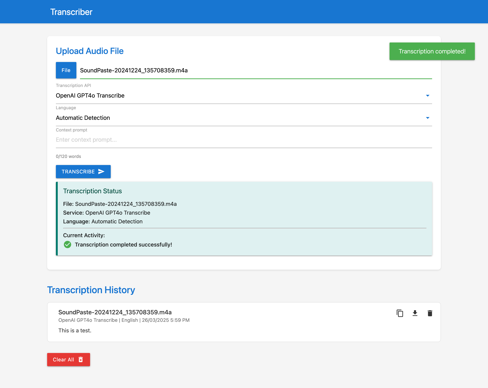

<!-- README.md -->

# Transcriber

## About This fork
This fork of the [arnoulddw/transcriber](https://github.com/arnoulddw/transcriber) focuses on the speed and accuracy of transcribing large audio and video files, such as lecture recordings, business meetings, conference presentations, etc. To take advantage of it, API accounts with a Usage Tier higher than Tier 1 are required. If you're just starting to use the OpenAI API and Gemini API or your audio recordings are short, the original repository is the best choice. Key differences of this fork:
- **Parallel transcription of several audio file segments** Several times faster than sequential processing for long records.
- **Segmentation of files on pauses in speech** Improves overall transcription quality.
- **Google Gemini /Vertex AI API option** Can be a good option for noisy recordings and lectures.
- **OpenRouter API option** Choose the best transcription model for the particular recordings.
- **Grok API option** Can be a good option for noisy recordings.
- **Configuration support reverse proxy** Can be installed as a personal transcription service on your personal domain behind the nginx with https and a secret access link.

| Source                 | Format | Size  | API       | Original transcriber   | Parallel processing (x10max) | Difference |
| ---------------------- | ------ | ----- | --------- | ---------------------- | ---------------------------- | ---------- |
| 02:05:06 meeting       |  m4a   | 61 MB | OpenAI 4o |     08 min 22 sec      |       01 min 25 sec          |    x5.9    |
| 01:08:22 earnings call |  webm  | 37 MB | OpenAI 4o |     04 min 35 sec      |       00 min 55 sec          |    x5      |
| 00:50:50 earnings call |  mp3   | 70 MB | OpenAI 4o |     04 min 56 sec      |       00 min 52 sec          |    x5.6    |
| 01:06:35 lecture       |  m4a   | 62 MB | OpenAI 4o |     04 min 55 sec      |       00 min 56 sec          |    x5.2    |
| 01:26:30 lecture       |  m4a   | 79 MB | OpenAI 4o |     05 min 55 sec      |       00 min 48 sec          |    x7.3    |


## About Transcriber
Transcriber is an audio and video transcription application with a user-friendly web interface. It allows you to upload audio or video files and get transcriptions using one of the supported APIs:

- **OpenAI GPT Transcribe** (new)
- **Google Gemini** (configurable model through Gemini API or Vertex AI)
- **OpenRouter** (new)
- **Grok Voice Transcribe 2.0** (new)
- **OpenAI Whisper** (depricated on OpenAI)
- **AssemblyAI**

The application automatically extracts audio from video files (using ffmpeg) and handles large files by splitting them into manageable chunks.

## Features

- **User-Friendly Web Interface:** A clean HTML/CSS/JavaScript frontend allows you to upload audio or video files, select an API and choose a language.
- **Video File Support:** Automatically extracts audio from video files (MP4, MOV, AVI, MKV, FLV, WMV, WebM) using ffmpeg before transcription.
- **Multiple Transcription APIs:** Choose from AssemblyAI, OpenAI Whisper, OpenAI GPT Transcribe, Gemini, Grok Voice Transcribe 2.0, or OpenRouter with almost any transcription model available.
- **Language Selection:** Choose your audio's language manually or use the automatic language detection for convenience.
- **Context Prompting:** Add context hints for OpenAI and general-purpose Gemini models to improve transcription of specialized terms (limited to 120 words). Gemini 3.5 Transcribe ignores context prompts.
- **Transcription History:** View, copy, download or delete previously transcribed audio.
- **Large File Handling:** Audio files larger than 10MB are automatically split into chunks on pauses in speech to overcome API limits.
- **Parallel File Processing**
- **Docker Deployment:** Simple deployment using Docker Compose or directly via Docker Hub.



## Usage

1. **Select Audio/Video Files:** Click "Files" to select one or more files from your computer. Supported formats:
   - Audio: MP3, M4A, WAV, OGG, WebM
   - Video: MP4, MOV, AVI, MKV, FLV, WMV, WebM
2. **Select API:** Choose OpenAI 4o transcribe, Google Gemini, Grok Voice Transcribe 2.0, OpenRouter, AssemblyAI or OpenAI Whisper from the dropdown menu.
3. **Select Language:** Choose the language of your audio or select "Automatic Detection."
4. **Add Context (Optional):** For OpenAI or general-purpose Gemini models, enter a context prompt to improve transcription accuracy (limited to 120 words). The prompt field is hidden for the dedicated Gemini transcription model.
5. **Transcribe:** Click **Transcribe** to start. The button changes to **Add to queue** when multiple files are selected or work is already in progress. Files upload in selection order and are transcribed one file at a time. You can select and add more files without waiting for transcription to finish. Each file keeps the provider, language, and context selected when it was added. Video files have their audio extracted automatically.
6. **View History:** Your transcriptions will appear in the "Transcription History" section, where you can copy, download or delete them.

Note: Keep the page open until uploads finish. Once the file is uploaded, all processing takes place on the server; you can close the page and return later to retrieve the results.

## Prerequisites
- **API Keys:**  
  You must have a valid API key for your selected provider: OpenAI, Gemini/Vertex, AssemblyAI, xAI (Grok), or OpenRouter. Sign up at their respective websites to obtain one.
- **Docker:**  
  Ensure Docker is installed and running on your machine.
- **Python 3.9-3.12 (if developing locally):**  
  !!! Python 3.13+ is not supported now.
  Recommended for local testing and development.

## Environment Variables

The application relies on several environment variables. You can specify these in your `.env` file or directly in your Docker Compose file.

| Variable                 | Description                                                                                           | Accepted Values                         | Default   |
| ------------------------ | ----------------------------------------------------------------------------------------------------- | --------------------------------------- | --------- |
| `TZ`                     | The timezone for the application.                                                                     | Any valid timezone string               | `UTC`     |
| `ASSEMBLYAI_API_KEY`     | Your API key for AssemblyAI.                                                                          | Your AssemblyAI API key                 | (none)    |
| `OPENAI_API_KEY`         | Your API key for OpenAI (used for both Whisper and GPT 4o Transcribe).                                | Your OpenAI API key                     | (none)    |
| `GEMINI_API_KEY`         | Your API key for Google Gemini (used for both Gemini API and Vertex AI).                              | Your Gemini/Vertex AI API key           | (none)    |
| `GEMINI_PROVIDER`        | Gemini provider 'google' for Gemini API, or 'vertex' for Vertex AI.                                   | `google`, `vertex`                      | `google`  |
| `VERTEXAI_PROJECT_ID`    | Your Google Cloud project id with Vertex AI API enabled.                                              | Your OpenAI API key                     | (none)    |
| `VERTEXAI_LOCATION`      | Your Google Cloud project location (used for both Gemini and Vertex AI).                              | See supported location on GC        | `us-central1` |
| `GEMINI_MODEL_NAME`      | Comma-separated Gemini models (Gemini API or Vertex AI); first is the default.                | See supported models on Google/GCP          |`gemini-pro-latest`|
| `OPENAI_MAX_CONCURRENCY` | Maximum allowed parallel threads accessing OpenAI API (for long files processing).                    | 1+                                      |   `4`     |
| `GEMINI_MAX_CONCURRENCY` | Maximum allowed parallel threads accessing Gemini/Vertex AI API (for long files processing).          | 1+                                      |   `4`     |
| `XAI_API_KEY` | Your xAI API key for Grok file transcription. | Your xAI API key | (none) |
| `OPENROUTER_API_KEY` | Your OpenRouter API key for file transcription. | Your OpenRouter API key | (none) |
| `OPENROUTER_MODEL_NAME` | Comma-separated OpenRouter speech-to-text models; first is the default. | OpenRouter STT model IDs | `elevenlabs/scribe-v2` |
| `OPENROUTER_MAX_CONCURRENCY` | Maximum parallel OpenRouter chunks within a file. | 1+ | `4` |
| `GROK_MAX_CONCURRENCY` | Maximum parallel Grok chunk transcriptions. | 1+ | `4` |
| `DEFAULT_TRANSCRIBE_API` | The default transcription API used when the application loads.                              | `gpt4o`, `gemini`, `grok`, `openrouter`, `assemblyai` or `whisper`      | `gpt4o`   |
| `DEFAULT_LANGUAGE`       | The default language for transcription on startup.                                                    | `auto`, `en`, `nl`, `fr`, `es`,`ru`     |  `auto`   |

[1]. [Gemini API in Vertex AI quickstart](https://cloud.google.com/vertex-ai/generative-ai/docs/start/quickstart?usertype=apikey)
[2]. [Generative AI on Vertex AI. Deployments and endpoints](https://cloud.google.com/vertex-ai/generative-ai/docs/learn/locations#available-regions)


### Selecting multiple models

Both model settings accept one model or a comma-separated list:

```dotenv
GEMINI_MODEL_NAME=gemini-pro-latest,gemini-4-argon,gemini-3.5-transcribe
OPENROUTER_MODEL_NAME=elevenlabs/scribe-v2,microsoft/mai-transcribe-2,mistralai/voxtral-mini-transcribe
```

Each model appears separately in the existing dropdown, such as **Google Gemini
(gemini-pro-latest)** or **OpenRouter (elevenlabs/scribe-v2)**. Spaces and empty
entries are ignored; duplicate models appear only once. The first model is the
default for its provider; `DEFAULT_TRANSCRIBE_API` still selects the default provider.
Restart the app and refresh the page after changing these settings.

Each upload saves its selected model with the queued job and transcription history.
Changing the dropdown or the configured list does not change already queued jobs.
Files still process one at a time. Existing databases gain an optional model field
automatically; older history retains its provider-only label. Jobs queued before
this feature have no saved model and use the provider's default when processed.
The context prompt follows the selected Gemini model and is hidden for
`gemini-3.5-transcribe`.

### Gemini file transcription

Set `GEMINI_API_KEY` and choose the model with `GEMINI_MODEL_NAME`, for example
`gemini-pro-latest`. The app shows **Google Gemini (gemini-pro-latest)** using the
configured model code. General-purpose models accept the optional context prompt along
with the audio and language instructions. The client uses the same model setting
for Gemini API and Vertex AI, including Vertex API-key connections.

The fallback model is `gemini-pro-latest` when no override is configured.
The optional dedicated model `gemini-3.5-transcribe` receives audio and language hints only; the prompt field is
hidden and any supplied context is ignored. See the [Gemini transcription documentation](https://docs.cloud.google.com/gemini-enterprise-agent-platform/models/gemini/3-5-transcribe).
The client supports `google-genai` 1.41.0 and newer. Restart the app after changing
configuration; Docker deployments should rebuild the image after code changes.

The app leaves thinking settings unset, using the model's default. Google documents
**High** as the default and highest supported level for Gemini 3.1 Pro, and **Medium**
as the default for Gemini 4 Argon (which also supports High). See Google's
[thinking configuration documentation](https://docs.cloud.google.com/gemini-enterprise-agent-platform/models/thinking).
The `gemini-pro-latest` alias can change over time; its reasoning default follows
the model it resolves to.

### Grok file transcription

Set `XAI_API_KEY` in `.env`, restart the app, and select **Grok Voice Transcribe 2.0**.
The client uses the [xAI speech-to-text API](https://docs.x.ai/developers/model-capabilities/audio/speech-to-text)
with model `grok-voice-transcribe-2.0`. It follows the GPT transcription client's splitting
policy (over 25 MiB or 500 seconds), parallel processing, progress reporting, and cleanup.
Automatic detection stores the language returned by xAI; split recordings use the most
frequent detected chunk language. Free-form context prompts are not supported for Grok.
This integration covers file uploads, including audio extracted from video.

To make Grok the default, set `DEFAULT_TRANSCRIBE_API=grok`. With Docker Compose,
also change the existing `DEFAULT_TRANSCRIBE_API=gpt4o` override in `docker-compose.yml`.

### OpenRouter file transcription

Set `OPENROUTER_API_KEY` in `.env` (or your VS Code launch environment), restart
the app, and select **OpenRouter (elevenlabs/scribe-v2)**. The label follows
your configured model. The default `OPENROUTER_MODEL_NAME` is
`elevenlabs/scribe-v2`; change it to use another OpenRouter speech-to-text model.
`OPENROUTER_MAX_CONCURRENCY` controls parallel chunks within a file (default: `4`).

The client follows the Grok template, using OpenRouter's
[`/api/v1/audio/transcriptions` endpoint](https://openrouter.ai/docs/guides/overview/multimodal/stt)
with multipart uploads. It keeps the existing 25 MiB / 500-second splitting policy,
retries, progress cards, and cleanup. Video audio extraction and the file queue also work.
The standard context prompt is ignored by OpenRouter, so it is not offered for this provider.
When the response omits its language, the selected language is used, or `unknown`
for automatic detection. Silent chunks are allowed, but an entirely empty transcript fails.

To make it the default, set `DEFAULT_TRANSCRIBE_API=openrouter`. With Docker Compose,
also update the existing default-provider override in `docker-compose.yml`.

## Installation and Deployment

You have two primary options for installation and deployment:

### Option 1: Using Docker Hub (Recommended)

This is the fastest way to get started.

1. **Pull the Docker Image:**

   ```bash
   docker pull ykharlamov/transcriber-app:latest
   ```

2. **Run the Docker Container:**

   ```bash
   docker run -d -p 5001:5001 \
     -e OPENAI_API_KEY="your_openai_api_key" \
     -e GEMINI_API_KEY="your_gemini_api_key" \
     -e OPENROUTER_API_KEY="your_openrouter_api_key" \
     -e ASSEMBLYAI_API_KEY="your_assemblyai_api_key" \
     -e XAI_API_KEY="your_xai_api_key" \
     -e OPENAI_MAX_CONCURRENCY=8 \
     -e GEMINI_MAX_CONCURRENCY=8 \
     -e OPENROUTER_MAX_CONCURRENCY=8 \
     -e GROK_MAX_CONCURRENCY=8 \
     -e DEFAULT_TRANSCRIBE_API="gpt4o" \
     -e DEFAULT_LANGUAGE="auto" \
     -e TZ="Your/Timezone" \
     --name transcriber-app \
     ykharlamov/transcriber-app:latest
   ```

   Replace `"Your/Timezone"`, `"your_openai_api_key"`, `"your_gemini_api_key"` and  `"your_assemblyai_api_key"` with your actual values.
   Set `"OPENAI_MAX_CONCURRENCY"` and `"OGEMINI_MAX_CONCURRENCY"` according to your API Usage Tiers, setting 8-10 parallel threads for OpenAI recommended for Usage Tier 3+ accounts, and your hardware must have enough resourses to process it. 
   Start small, with 3-4 threads, and try to increase later. Increasing the number of threads beyond your account's API Tier limits will result in retries. This will increase the overall processing time, not decrease it, and may increase API costs too.


### Option 2: Using Docker Compose

For further customization or local development, use Docker Compose.

1. **Clone the Repository:**

   ```bash
   git clone https://github.com/jur7/transcriber
   cd transcriber
   ```

2. **Configure Environment Variables in docker-compose.yml**

   Update the `docker-compose.yml` file with your API keys and other environment variables under the `environment` section. An example configuration:

   ```yaml
   services:
     transcriber:
       build:
         context: .
         dockerfile: Dockerfile
       ports:
         - "5001:5001"
       volumes:
         - ./backend:/app/backend
         - ./temp_uploads:/app/temp_uploads
       environment:
         - TZ=${TZ:-UTC}
         - ASSEMBLYAI_API_KEY=your_assemblyai_api_key
         - OPENAI_API_KEY=your_openai_api_key
         - DEFAULT_TRANSCRIBE_API=${DEFAULT_TRANSCRIBE_API:gpt4o}
         - DEFAULT_LANGUAGE=${DEFAULT_LANGUAGE:auto}
       restart: unless-stopped
   ```

3. **Build and Run:**

   From the project’s root directory, run:

   ```bash
   docker-compose up -d --build
   ```

4. **Access the Application:**

   Open your browser and navigate to [http://localhost:5001](http://localhost:5001)

### Option 3: Local Development (Without Docker)

1. **Set up a Virtual Environment:**

   On Mac/Linux (most cases)
   ```bash
   python3 -m venv venv
   ```

   On Windows (most cases)
   ```bash
   python -m venv venv
   ```

2. **Activate the Virtual Environment:**

   - On macOS/Linux:
     ```bash
     source venv/bin/activate
     ```
   - On Windows:
     ```bash
     venv\Scripts\activate
     ```

3. **Install Dependencies:**

   ```bash
   pip install -r requirements.txt
   ```

4. **Configure Environment Variables:**

   Create a `.env` file with your API keys and preferences:

   ```env
   ASSEMBLYAI_API_KEY=your_assemblyai_api_key
   OPENAI_API_KEY=your_openai_api_key
   GEMINI_API_KEY=your_gemini_api_key
   XAI_API_KEY=your_xai_api_key
   OPENROUTER_API_KEY=your_openrouter_api_key
   OPENROUTER_MODEL_NAME=elevenlabs/scribe-v2
   OPENROUTER_MAX_CONCURRENCY=4
   GEMINI_PROVIDER=google  # 'google' for Gemini API, or 'vertex' for Vertex AI
   VERTEXAI_PROJECT_ID=your_gcp_project_id
   VERTEXAI_LOCATION=us-central1
   GEMINI_MODEL_NAME=gemini-pro-latest
   OPENAI_MAX_CONCURRENCY=8
   GEMINI_MAX_CONCURRENCY=8
   DEFAULT_TRANSCRIBE_API=gpt4o
   TZ=Your/Timezone
   ```

5. **Run the Application:**

   #### Option A. Start from console.
   ```bash
   python -m flask --app app run --port 5001
   ```
   #### Option B. Start from console in debug mode.
   ```bash
   python -m flask --app app run --port 5001 --debug
   ```
   #### Option C. Debug in Visual Studio Code
   1. Create .vscode folder
   2. Place launch.json and settings.json into .vscode folder
   3. Set your API keys in the launch.json file (if not presented as env variables) or delete these lines (if present)
   4. Install in VS Code Python extension.
   5. Open the folder in VS Code, press F5 to start debugging.


6. **Access the Application:**

   Open [http://localhost:5001](http://localhost:5001) in your browser.

## Troubleshooting

- **Port 5001 is in use:** If this port is occupied, update the port mapping in the `docker-compose.yml` file or your Docker run command.
- **API Key Issues:** Ensure your API keys are entered correctly and that your AssemblyAI and OpenAI accounts are active.
- **File Upload Issues:** Verify that your audio file is in a supported format (mp3, mpga, m4a, wav, or webm).
- **Docker Errors:** Confirm Docker is running properly and that you have the necessary permissions.


## Advanced installation #1. HTTPS with Nginx + Certbot

## Advanced installation #1a. HTTPS with Nginx + Certbot. Access via secret link.

## Advanced installation #2. Storing transcription database outside of the Docker container.

You can store transcriptions database and uploads directory outside of the container. This application contains internal database version control and DB structure patching process for this case. When installing a new version of the Docker container, the DB structure will be updated at startup, so user all data will be preserved.

   ```bash

   docker run -d -p 5001:5001 \
     -e TZ="Your/Timezone" \
     -e ASSEMBLYAI_API_KEY="your_assemblyai_api_key" \
     -e OPENAI_API_KEY="your_openai_api_key" \
     -e GEMINI_API_KEY="your_gemini_api_key" \
     -e DEFAULT_TRANSCRIBE_API="gpt4o" \
     -e OPENAI_MAX_CONCURRENCY=8 \
     -e GEMINI_MAX_CONCURRENCY=8 \
     -e DEFAULT_LANGUAGE="auto" \
     --name transcriber-app \
     ykharlamov/transcriber-app:latest

   ```

## Advanced installation #3. HTTPS and pay-as-you-go with Google Cloud.RUN service.

## Advanced installations. Special notes.


## What transcription model is the best
Virtually all major vendors claim their models perform best in tests. However, reality often differs significantly from test conditions. Factors such as recording environments, audio quality, and the languages ​​involved—especially when multiple languages ​​are mixed—mean that comparative benchmarks should serve only as a starting point for evaluation. If transcription quality is a critical factor, it is advisable to select a few models that perform well in tests and then evaluate them using your own specific audio files.  [Artificial Analysis Speech to Text AI Model & Provider Leaderboard](https://artificialanalysis.ai/speech-to-text/non-streaming)


## License

This project is licensed under the MIT License.
